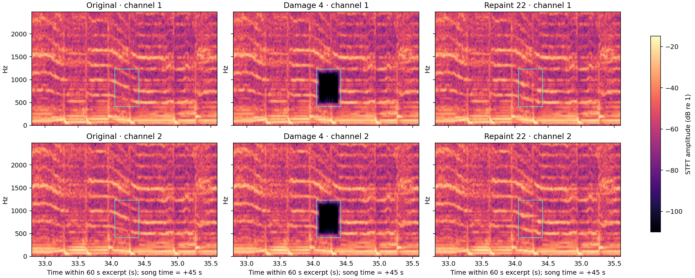
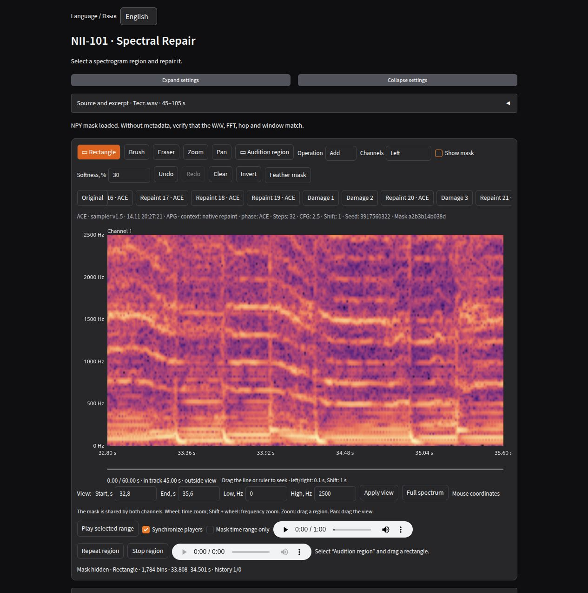

# Spectral Repair v0.1.1 · NII-101

[Русский](README.ru.md) · [Demo](docs/demo/README.md) · [Release checks](docs/RELEASE_CHECKS.md)

A local spectrogram editor for repairing selected time–frequency regions with DSP
or an experimental ACE-Step 1.5 sampler. Draw a mask, audition a region, generate
a replacement, and compare saved versions with synchronized audio.



## Features

- Stereo spectrogram with rectangle, brush, eraser, undo/redo and mask import/export.
- Time/frequency zoom, pan, draggable playback position and region audition.
- DSP interpolation in time or frequency and a notch filter for narrow tonal defects.
- ACE-Step controls: steps, guidance, shift, seed, conditioning and spectral projection.
- History tabs with audio, artificial-damage previews, saved WAVs and run reports.

The interface defaults to English. Use **Language / Язык** to switch to Russian;
your choice is remembered locally. Switching language preserves the mask, history
and generation settings. This is a research tool; generated content can
change timbre or musical details and is not an exact recovery of missing samples.

## How it works

The audio is analyzed with STFT. A shared stereo mask **M[time, frequency]** selects
the coefficients to replace. DSP supplies an interpolated candidate, or ACE-Step
supplies a generated candidate. The experimental sampler also projects spectral
constraints during sampling using the audio VAE. Latent channels are not literal
frequency bins. Final complex substitution is localized by the STFT mask, followed
by inverse STFT. Window support can extend beyond frame centers, and reanalysis can
show small changes outside selected frequency bins. No global normalization or
resampling is applied. See [architecture](acestep/experiments/spectral_repair/ARCHITECTURE.md).

## Requirements

- Python **3.11–3.12**; Linux x86_64 is the verified editor platform.
- An installed [ACE-Step 1.5 backend](https://github.com/ace-step/ACE-Step-1.5).
- Stereo **48 kHz WAV** for ACE; DSP supports mono/stereo at the selected STFT rate.
- CUDA GPU for the editor's ACE path; the recorded 60 s run used an RTX 3060,
  about 9.32 GiB peak PyTorch allocated memory and 6.75 GiB process peak RSS.
  These are one-run observations, not universal minimum requirements.
- Enough disk for the backend environment, separately downloaded models and WAV history.

The editor's current device selector exposes `cuda:0` and `cuda:1`. DSP processing
runs on CPU. Backend support for other accelerators does not imply that this editor's
GPU paths have been tested on them. FFmpeg is not required for the supported WAV-only workflow;
backend tools or additional media formats may require it.

## Install

Keep the two checkouts as siblings. Use the backend's dependency setup to retain
its platform-specific PyTorch and local package configuration:

```bash
# From the parent directory containing this spectral-repair checkout:
git clone https://github.com/ace-step/ACE-Step-1.5.git
cd ACE-Step-1.5
git checkout 6c03a03c96e1d37969493b11f4e14f0545b1866d
uv sync
uv pip install --python .venv/bin/python --no-deps -e ../spectral-repair
cd ../spectral-repair
ln -s ../ACE-Step-1.5/.venv .venv
```

Skip the symlink step if this checkout already has its own environment. In that
case install the backend and this project into that environment. Do not replace
an existing environment or model directory. The pinned backend commit is the
version used by the saved demo; other versions are not yet validated.

### Models

Follow the [official model setup](https://github.com/ace-step/ACE-Step-1.5).
Place these directories in the backend's `checkpoints/`:

- `acestep-v15-base/`: [ACE-Step Base](https://huggingface.co/ACE-Step/acestep-v15-base).
- `vae/`: audio VAE from [ACE-Step 1.5](https://huggingface.co/ACE-Step/Ace-Step1.5).
- `Qwen3-Embedding-0.6B/`: [text encoder](https://huggingface.co/Qwen/Qwen3-Embedding-0.6B).

Model downloads are a separate, explicit installation step. Weights are not in
this repository. The repair provider does not load the optional music LM. The
experimental spectral sampler requires Base / Euler ODE; do not assume Turbo is equivalent.
[Demo model checksums](docs/demo/checkpoints.sha256.json) identify the recorded assets.

## Run

```bash
./start.sh --project-root ../ACE-Step-1.5 --device cuda:0
```

Open **http://127.0.0.1:7863/**. The server binds to localhost and does not request
public Gradio sharing. `--port` changes the port. Alternatively set
`SPECTRAL_REPAIR_BACKEND` to the backend root. Command-line arguments override
saved defaults. `var/session.json`, when present, retains local startup paths;
`var/runs/` contains results. Neither is committed.

## Quick guide

1. Open the source/fragment panel, select a WAV and choose the excerpt. Build the spectrogram.
2. Draw with rectangle or brush. Use eraser or undo to correct the mask; enable “Show mask” to see it.
3. Zoom/pan to inspect detail. Drag the playback marker; use “Audition region” to audition a time/frequency rectangle.
4. Choose DSP or ACE-Step. Set ACE parameters in the collapsible panel; choose the intended phase/blending mode.
5. Press “Repair selection”. Compare history tabs, their audio and spectrograms.
6. Save mask NPY/metadata or collect `repaired.wav` and `settings.json` from the run directory shown in the UI.

Selecting a history tab changes the displayed/listened version; it does not silently
make it the source for subsequent repairs. The mask is shared across history tabs.
Use the test-damage panel to preview a hole before repair. A notch filter is for a
narrow tone, not for reconstructing a wide missing band.



## Demonstration and limits

[Original → Damaged → Repaired](docs/demo/README.md) documents saved **Damage 4 /
Repaint 22**, exact parameters, mask and spectral differences. It does not rerun
or replace the original generation. About **99.843%** of the final difference's
spectral energy was inside this mask; outside its time-window support the saved
WAV difference was zero. This is localization of the final assembly, not proof
of model locality or superiority over other editors. Audio waveform RMSE to the
reference increased in this particular run; perceptual quality requires listening.

The demo includes the full test source, working excerpt, damaged input, repair,
raw candidate and DSP control, with the owner's permission. Metadata-cleaned WAVs,
parameters, mask and replay scripts are in [docs/demo](docs/demo/README.md).
Audio has separate [usage notes](THIRD_PARTY_NOTICES.md#demo-audio); the code MIT
license does not automatically relicense it. Account screenshots, song links and
unrelated private recordings are not included.

Wide masks may produce unstable or unrelated content. VAE round trips, generated
phase and imperfect context conditioning can alter sound. GPU results can differ
across hardware/drivers even with a fixed seed. No claim of commercial-editor
superiority or unchanged material inside the selected region is made.

## Tests

```bash
./test.sh
```

The CPU suite covers masks, STFT reconstruction, stereo, alignment, DSP, history,
playback controls and generation adapters using mocks where appropriate. GPU
integration is reported separately; passing mocks is not a GPU-generation check.
See [PASS / FAIL / NOT RUN report](docs/RELEASE_CHECKS.md).

## License

Project code: [MIT](LICENSE). ACE-Step and other dependencies retain their own
licenses; model weights and demo audio are not relicensed by this project's MIT
license. See [third-party notices](THIRD_PARTY_NOTICES.md) and the dependency inventory.
