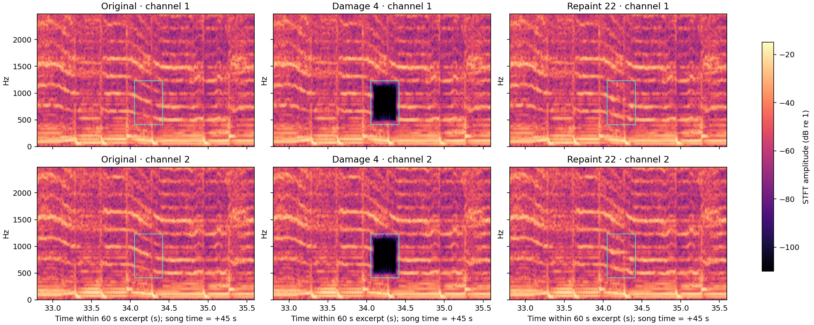
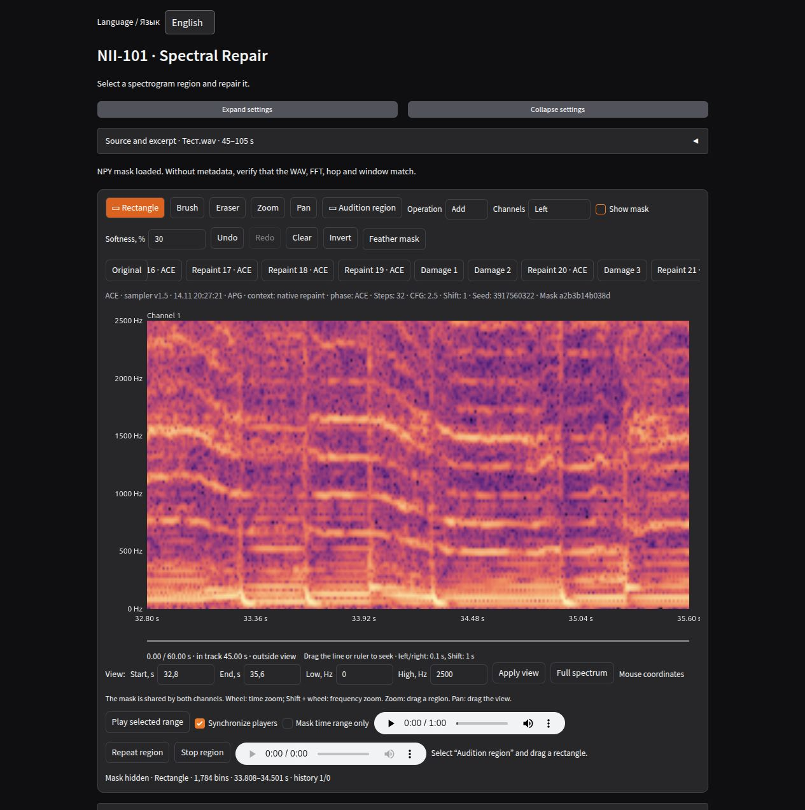

# Spectral Repair v0.1.0 · НИИ-101

[English](README.md) · [Эксперимент](docs/demo/README.md) · [Проверки](docs/RELEASE_CHECKS.md)

Локальный спектральный редактор: выделите частотно-временную область, прослушайте
её и восстановите через DSP или экспериментальный sampler ACE-Step 1.5.
История позволяет сравнивать версии по звуку и спектрограммам.



## Возможности

- Стереоспектрограмма, прямоугольник, кисть, ластик, отмена/повтор, импорт/экспорт масок.
- Масштаб времени и частоты, перемещение вида, перетаскиваемый маркер воспроизведения.
- Прослушивание выделенного частотно-временного прямоугольника.
- DSP-интерполяция по времени/частоте и notch для узких паразитных тонов.
- Настройки ACE: шаги, guidance, shift, seed, контекст и спектральная проекция.
- Вкладки истории со звуком, тестовые провалы, сохранение WAV и отчётов запуска.

По умолчанию интерфейс английский. Переключатель **Language / Язык** включает русский;
выбор сохраняется в браузере. Смена языка сохраняет маску, историю и настройки
генерации. Это исследовательский инструмент: генерация может менять
тембр и музыкальные детали; точное возвращение утраченных отсчётов не обещается.

## Принцип работы

STFT переводит звук в комплексный спектр. Общая для стереоканалов маска
**M[время, частота]** выбирает заменяемые компоненты. DSP строит интерполированный
кандидат, ACE — сгенерированный. Наш sampler дополнительно проецирует спектральные
ограничения через аудио-VAE между шагами. Каналы латента не равны частотным бинам.
После смешивания по маске выполняется обратный STFT. Опора окон шире центров кадров;
повторный анализ может показать небольшую утечку за частотную границу маски.
Глобальная нормализация и ресемплинг не выполняются.
[Подробнее об архитектуре](acestep/experiments/spectral_repair/ARCHITECTURE.md).

## Требования

Python **3.11–3.12**, установленный [ACE-Step 1.5](https://github.com/ace-step/ACE-Step-1.5).
Проверенная платформа редактора — Linux x86_64. Для ACE нужен стерео WAV **48 кГц**
и CUDA GPU; селектор сейчас предлагает `cuda:0` и `cuda:1`. DSP работает на CPU
с моно/стерео при частоте STFT. Поддержка других ускорителей самим ACE не означает,
что соответствующие режимы проверены в этом редакторе.

Сохранённый 60-секундный эксперимент выполнен на RTX 3060: пик аллокаций PyTorch
около 9,32 GiB, peak RSS процесса около 6,75 GiB. Это наблюдения одного запуска,
а не универсальные минимальные требования. Нужен запас диска для среды, моделей
и истории WAV. Для WAV-сценария FFmpeg не требуется; другие инструменты backend
могут его требовать.

## Установка и модели

Разместите оба проекта рядом. Сначала установите зависимости самого ACE:

```bash
# Из родительской папки, где уже лежит spectral-repair:
git clone https://github.com/ace-step/ACE-Step-1.5.git
cd ACE-Step-1.5
git checkout 6c03a03c96e1d37969493b11f4e14f0545b1866d
uv sync
uv pip install --python .venv/bin/python --no-deps -e ../spectral-repair
cd ../spectral-repair
ln -s ../ACE-Step-1.5/.venv .venv
```

Если окружение проекта уже существует, не заменяйте его ссылкой: установите ACE
и редактор в него. Проверен указанный commit backend; другие версии требуют проверки.
Инструкции [официальной установки](https://github.com/ace-step/ACE-Step-1.5)
описывают особенности PyTorch и системы.

Отдельно скачайте модели в `checkpoints/` backend:

- `acestep-v15-base/` — [Base](https://huggingface.co/ACE-Step/acestep-v15-base).
- `vae/` — аудио-VAE из [ACE-Step 1.5](https://huggingface.co/ACE-Step/Ace-Step1.5).
- `Qwen3-Embedding-0.6B/` — [текстовый энкодер](https://huggingface.co/Qwen/Qwen3-Embedding-0.6B).

Веса не включены в Git и не скачиваются этой задачей. Дополнительная музыкальная LM
для восстановления не загружается. Спектральный sampler рассчитан на Base / Euler ODE;
Turbo нельзя считать эквивалентной заменой.
[Хеши моделей эксперимента](docs/demo/checkpoints.sha256.json).

## Запуск

```bash
./start.sh --project-root ../ACE-Step-1.5 --device cuda:0
```

Откройте **http://127.0.0.1:7863/**. Сервер локальный, публичный Gradio sharing выключен.
Порт меняется через `--port`. Путь backend также задаётся переменной
`SPECTRAL_REPAIR_BACKEND`. Аргументы команды имеют приоритет над сохранёнными
настройками. `var/session.json` хранит локальные пути запуска, `var/runs/` — результаты;
оба исключены из Git.

## Краткое руководство

1. Разверните «Исходник и фрагмент», выберите WAV, начало и длительность; постройте спектрограмму.
2. Нарисуйте маску прямоугольником или кистью. Исправьте ластиком/отменой. Включите «Показать маску».
3. Приблизьте нужную область, перемотайте маркером. «Прослушать область» выделяет прямоугольник по времени и частоте.
4. Выберите DSP или ACE-Step. Настройки ACE находятся в сворачиваемой панели; проверьте режим фазовой подстановки.
5. Нажмите «Восстановить выделение». Сравните вкладки истории со звуком и спектрограммой.
6. Сохраните маску с метаданными; итоговый WAV `repaired.wav` и настройки `settings.json` лежат в папке запуска, указанной в панели.

Переключение истории меняет отображение/прослушивание, но не подменяет исходник
для следующей обработки. Маска общая для вкладок. Тестовая панель позволяет
показать провал перед восстановлением. Notch убирает узкий тон и не предназначен
для заполнения широкой пропавшей полосы.



## Демонстрация и ограничения

[Исходник → Провал 4 → Репеинт 22](docs/demo/README.md): сохранённые параметры,
маска, спектрограммы и разность до/после. Новые результаты вместо старых не создавались.
В этом эксперименте **99,843%** энергии спектральной разности финального результата
лежит внутри маски; вне её временной опоры разность WAV равна нулю. Это свойство
финальной сборки, не доказательство локальности кандидата ACE или превосходства
звучания. RMSE к исходнику в данном запуске выросла; качество оценивается также на слух.

С разрешения владельца включены полный тестовый исходник, рабочий фрагмент,
повреждённый вход, репеинт, кандидат ACE и DSP-контроль. WAV с очищенными
метаданными, маска, параметры и скрипты воспроизведения лежат в [docs/demo](docs/demo/README.md).
Для аудио действуют отдельные [примечания](THIRD_PARTY_NOTICES.md#demo-audio);
MIT собственного кода не перелицензирует запись. Скриншоты аккаунта, ссылки на
песни и посторонние личные записи не включены.

На широких масках модель может менять музыку сильнее ожидаемого. VAE, генерация
фазы и контекст влияют на результат. Один seed не гарантирует побитового совпадения
между разными GPU/драйверами. Заявлений о превосходстве над коммерческими редакторами нет.

## Тестирование

```bash
./test.sh
```

CPU-тесты проверяют маски, STFT/iSTFT, стерео, сдвиг, DSP, историю, плееры и адаптеры;
модели при необходимости заменены mock. Проверка с GPU учитывается отдельно.
[Отчёт PASS / FAIL / NOT RUN](docs/RELEASE_CHECKS.md).

## Лицензия

Собственный код — [MIT](LICENSE). Сторонние компоненты сохраняют свои лицензии;
веса и аудио не перелицензируются нашей MIT. См. [уведомления](THIRD_PARTY_NOTICES.md)
и инвентаризацию зависимостей.
