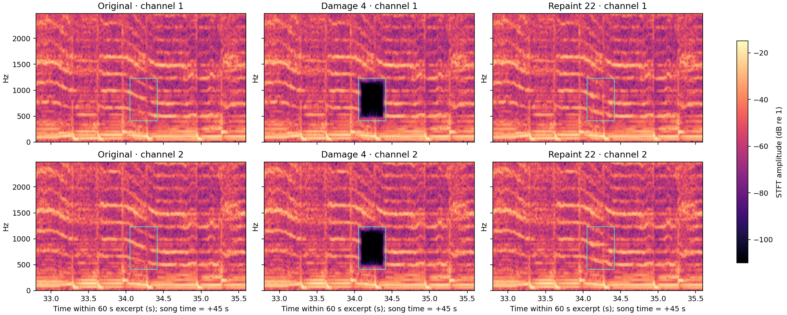
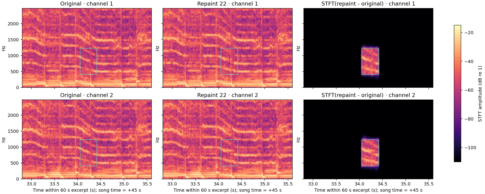

# Saved demonstration · Damage 4 → Repaint 22

[Application](../../README.md) · [Русский](../../README.ru.md)

This is the saved experiment, not a new generation. Rows in the figures represent
the left and right stereo channels, not different experiments.

## Original → Damaged → Repaired

| Stage | Full working excerpt |
|---|---|
| Original | [original-excerpt.wav](audio/original-excerpt.wav) |
| Damage 4 | [damage-4.wav](audio/damage-4.wav) |
| Repaint 22 | [repaint-22.wav](audio/repaint-22.wav) |

Additional inputs/controls: [complete source, 112.56 s](audio/original-full.wav),
[raw ACE candidate](audio/candidate-22.wav), [DSP control](audio/dsp-control.wav).
All working versions are 60 seconds, stereo 48 kHz. The excerpt covers source
seconds 45–105. The complete test track is included with the owner's permission.





[Full spectrograms](images/before-after-full.png) ·
[Full difference spectrum](images/difference-full.png) ·
[Spectral amplitude change](images/magnitude-change.png)

Damage 4 (`damage-0bff6272faa8`) and Repaint 22 (`2d437ead9034`) use exactly the same
mask. The damaged audio is sample-identical to the model input. The model sees the
damaged WAV; the original serves as reference and does not backfill the final hole.

The mask covers approximately excerpt seconds 34.037–34.432 and 421.875–1242.188 Hz.
Its exact shape is in [mask.npz](mask.npz), key `mask`: float64 [5626,1025], shared
by both channels. Frame i means i×512/48000 s; bin j means j×48000/2048 Hz.

## Settings and measurements

[parameters.json](parameters.json) contains the full replay request, description,
empty lyrics, offset/duration, STFT, sampler and fixed seed **3917560322**.
[settings.json](settings.json) is the original run report with portable source paths
and can be imported into the editor. [Environment](environment.json),
[dependency freeze](requirements.freeze.txt), [model checksums](checkpoints.sha256.json).
The root checkout supplies the editor/sampler implementation; use the backend commit
recorded in the environment metadata. Weights are installed separately.

Base, Euler ODE, native APG, spectral sampler v1.5; 32 steps, CFG 2.5, shift 1;
initial noise 1, projection every 4 steps, native repaint context, temporal anchoring
off, complex final blending, artificial `band_loss`.

[metrics.json](metrics.json) is calculated from these saved WAVs. Spectrograms use
one absolute −110…−15 dB re 1 scale. Cyan outlines the nonzero mask.

- Difference: STFT(repaired − original), including amplitude and phase.
- Signed level map: 20log10|STFT(repaired)| − 20log10|STFT(original)|, ±12 dB;
  bins below −80 dB in both signals are hidden.
- 99.843% of difference spectral energy is inside this mask, 0.157% outside.
- Outside the mask's time-window support, saved waveform difference is exactly zero.
- Reference waveform RMSE: repair 0.004902; damaged input 0.002994.

This shows localized final assembly, not exact sample recovery or perceptual
superiority. It does not establish locality of the raw ACE candidate. Historical
37.3% / 99.994% observations belonged to another experiment and are not used here.

## Reproduce

Run from the project root with its installed environment:

```bash
# CPU: verify checksums, source signature, mask, damage and final assembly.
.venv/bin/python -B docs/demo/scripts/reproduce.py

# Regenerate spectrograms and metrics from the supplied WAVs.
MPLCONFIGDIR=/tmp/spectral-plots .venv/bin/python -B docs/demo/scripts/plots.py

# Optional GPU: generate a new candidate and repair into var/demo-reproduced/.
.venv/bin/python -B docs/demo/scripts/reproduce.py --run \
  --backend ../ACE-Step-1.5 --device cuda:0
```

The default command does not load a model. It prints `VERIFIED` after checking all
[SHA-256 hashes](SHA256SUMS), creating the same damage and rebuilding the final
waveform from the saved float32 candidate. The assembly maximum error is about
2.58×10⁻⁸ per sample; the check allows 2×10⁻⁷ because the original candidate was
stored as float32. GPU replay checks model hashes first, prints progress, and saves
its result separately. It does not overwrite these reference files.

For manual UI reproduction, unpack the mask:

```python
import numpy as np
np.save('mask.npy', np.load('docs/demo/mask.npz', allow_pickle=False)['mask'])
```

Load `audio/original-full.wav`, offset 45 s, duration 60 s, FFT 2048 / hop 512 / Hann;
import `settings.json` and the unpacked mask. Check the sampler options in
`parameters.json`, especially noise 1, every 4 steps, native repaint context and
complex blending. Importing generation settings alone does not configure every
sampler/STFT/editor option automatically. Fixed seeds do not guarantee bit-identical
GPU results across different hardware or drivers. No new GPU run was made for export.

## Audio provenance and file integrity

The source is Suno-generated instrumental test material, supplied for this
experiment. Account screenshots, account names, song URLs and unrelated private
recordings are not included. [Audio usage notes](../../THIRD_PARTY_NOTICES.md#demo-audio)
are separate from the code MIT license.

All six WAV copies have ancillary metadata removed without resampling,
normalization or changes to their sample bytes. [metadata-audit.json](metadata-audit.json)
records technical format and data hashes. This records the export operation, not a
claim to erase audible provenance or grant rights through metadata removal.
The original private exports and full local archive remain preserved.
